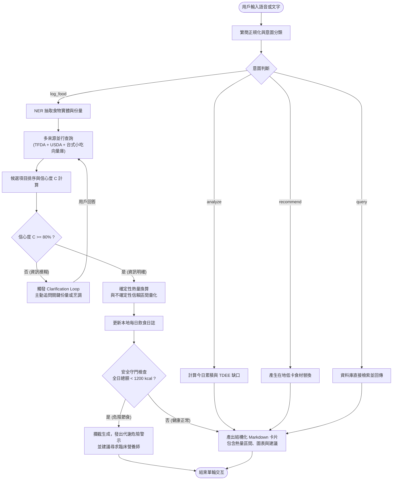

# DietSense 八大模組架構與演算法規格書

本規格書完整對應《期末專題提案作業規範》第四節之技術表示要求，詳述 DietSense 對話式個人化熱量與營養管理 Domain AI Agent 之模組職責、互動流程、帶行號核心演算法虛擬碼，以及能量代謝與不確定性量化之數學形式。

## 一、八大核心系統模組定義

系統架構將「語意理解與協調」與「確定性數值運算」完全解耦，八大模組定義如下：

1. **① User/Application Scenario (用戶情境模組)**:
   - 職責：提供跨平台對話式介面（手機 App 或 Web Chat），支援使用者以文字或語音輸入日常零散、非結構化之飲食描述（例：「午餐吃了一碗加蛋牛肉麵，湯喝一半」）。
   - 輸出契約：原始語音音訊串流或原始繁中文字字串。

2. **② Query/Input Processing (輸入處理模組)**:
   - 職責：透過 OpenAI Whisper 模型完成語音轉文字（STT）；進行繁簡中文正規化與標點符號標準化；調用輕量意圖分類器進行四元分類：`log_food`（記錄飲食）、`query_nutrition`（查詢成分）、`analyze`（分析代謝平衡）、`recommend`（取得改善建議）。
   - 輸出契約：標準化文字 Query 與對應之 Intent 標籤。

3. **③ Planner & Reasoning Agent (推理核心模組)**:
   - 職責：基於大語言模型（GPT-4o 或 Gemini 1.5 Pro）之 Function Calling 機制，解析對話歷史 Context；抽取食物實體名稱、份量描述、用餐時間與烹調方式；當資訊模糊或檢索相似度低於 80% 時，生成針對性之單一澄清問題。
   - 輸出契約：結構化工具調用參數（Tool Call Arguments）或向使用者發起之澄清問題。

4. **④ Data Acquisition/Retrieval (資料取得與檢索模組)**:
   - 職責：平行查詢三層營養數據庫：
     - 美國農業部 USDA FoodData Central API（900,000+ 基礎食材項目）；
     - 台灣衛生福利部食品成分資料庫（TFDA，6,000+ 本土食材）；
     - 自建台式外食小吃料理向量資料庫（基於 Dense Embedding 之 RAG 檢索）。
   - 輸出契約：候選食材清單、各項巨量營養素每 100g 含量，以及語意比對置信分數 $C$。

5. **⑤ Analytics Engine (分析計算引擎)**:
   - 職責：嚴格採用確定性 Python 數值函式計算：
     - 食物熱量點估計：$E = \text{Portion(g)} \times \text{kcal}_{100\text{g}} / 100$；
     - 基礎代謝率（BMR）與全日總能量消耗（TDEE）（採 Mifflin-St Jeor 公式）；
     - 動態不確定性信賴區間（Confidence Interval）。
   - 輸出契約：熱量區間 $[E_{\text{low}}, E_{\text{high}}]$、巨量營養素克數與能量缺口值。

6. **⑥ Domain Knowledge Integration (領域知識整合模組)**:
   - 職責：整合臨床營養指引與公共衛生邊界規則：
     - AMDR 巨量營養素黃金比例（碳水 45-65%、蛋白 10-35%、脂肪 20-35%）；
     - 衛福部每日飲食指南份量對照標準；
     - 臨床安全硬性規則：成人每日最低攝取下限 1,200 kcal/天。
   - 輸出契約：營養比例健康評分、臨床安全狀態標記（OK / WARNING / DANGER）。

7. **⑦ Decision/Recommendation (決策建議模組)**:
   - 職責：依據當日剩餘熱量配額、巨量營養素缺乏指標及用餐生活情境（便利商店、夜市、熱炒），檢索並產生等飽足感但熱量密度較低之在地食材替代方案。
   - 輸出契約：具可執行性、在地化之下一餐飲食配置建議。

8. **⑧ Output & Interaction (輸出互動模組)**:
   - 職責：將數值結果、圖表標記（巨量營養素比例圓餅圖、趨勢圖）與文字建議格式化為清晰之 Markdown 卡片，並給予後續輪次之引導建議。
   - 輸出契約：渲染至前端畫面的結構化對話回應。

---

## 二、系統流程圖核心邏輯 (Flowchart Logic)



---

## 三、核心演算法虛擬碼 (Algorithm Pseudocode with Line Numbers)

```python
01: """
02: Algorithm 1: DietSense Domain AI Agent Execution Pipeline
03: Input : User Query Q, User Profile P, Daily Food Log D
04: Output: Agent Response R, Updated Daily Food Log D'
05: """
06: def diet_agent_pipeline(Q: str, P: UserProfile, D: DailyLog) -> tuple[Response, DailyLog]:
07:     # Step 01: 語意前處理與繁簡標準化
08:     Q_norm = normalize_natural_language(Q)
09:     
10:     # Step 02: 意圖分類器 (Intent Classification)
11:     intent = classify_intent(Q_norm)  # intent in {log_food, query_nutrition, analyze, recommend}
12:     
13:     # Step 03: 記錄飲食分支 (log_food)
14:     if intent == "log_food":
15:         entities = extract_food_entities(Q_norm)  # 抽取食物實體、份量詞、餐別
16:         for item in entities:
17:             candidates = []
18:             candidates += query_taiwan_food_db(item.name)       # 台灣 TFDA 6,000+ 食物
19:             candidates += query_usda_api(item.name)             # 美國 USDA 900,000+ 食物
20:             candidates += query_taiwan_vector_rag(item.name)    # 台式小吃向量 RAG 庫
21:             
22:             best_match, confidence = rank_candidates(candidates, item.context)
23:             
24:             # 信心度閾值檢查 (Confidence Thresholding & Clarification Loop)
25:             if confidence < 0.80:
26:                 prompt_msg = generate_clarification_prompt(item, candidates)
27:                 user_clarification = await ask_user_interactive(prompt_msg)
28:                 item = update_entity_with_clarification(item, user_clarification)
29:                 best_match, confidence = rank_candidates(query_all_databases(item.name), item.context)
30:                 
31:             # 確定性熱量計算與不確定性傳遞量化
32:             grams = estimate_portion_grams(item.portion, best_match.standard_unit)
33:             kcal_point = (grams * best_match.kcal_per_100g) / 100.0
34:             kcal_low, kcal_high = compute_uncertainty_interval(kcal_point, confidence)
35:             
36:             D.add_entry(food=best_match, portion_g=grams, 
37:                         kcal_point=kcal_point, bounds=(kcal_low, kcal_high), 
38:                         timestamp=item.meal_time)
39:                         
40:     # Step 04: 代謝分析分支 (analyze)
41:     elif intent == "analyze":
42:         daily_total = sum(entry.kcal_point for entry in D.entries)
43:         macro_ratio = compute_macronutrient_ratio(D)
44:         bmr = compute_mifflin_bmr(P.weight_kg, P.height_cm, P.age, P.gender)
45:         tdee = bmr * P.activity_factor
46:         deficit = daily_total - tdee
47:         
48:     # Step 05: 個性化飲食建議分支 (recommend)
49:     elif intent == "recommend":
50:         recommendation = generate_taiwan_diet_alternatives(D, P)
51:         
52:     # Step 06: 臨床安全守門防護 (Safety Guardrails)
53:     safety_status = evaluate_safety_guardrails(D, P)
54:     if safety_status == "DANGER":
55:         safety_alert = construct_safety_warning(reason="Extreme Caloric Deficit (<1200 kcal/day)")
56:         return format_response(alert=safety_alert, allow_restrictive_plan=False), D
57:         
58:     # Step 07: 產出結構化回應卡片與圖表標記
59:     R = format_comprehensive_response(
60:         intent=intent, daily_log=D, 
61:         analytics=(daily_total, tdee, deficit) if 'daily_total' in locals() else None,
62:         recommendations=recommendation if intent == "recommend" else None,
63:         sources=[e.food.source for e in D.entries]
64:     )
65:     return R, D
```

---

## 四、數學形式化與動態量化公式

### 1. Mifflin-St Jeor 能量代謝公式
$$
\text{BMR}_{\text{male}} = 10 \times W(\text{kg}) + 6.25 \times H(\text{cm}) - 5 \times A(\text{years}) + 5
$$
$$
\text{BMR}_{\text{female}} = 10 \times W(\text{kg}) + 6.25 \times H(\text{cm}) - 5 \times A(\text{years}) - 161
$$
$$
\text{TDEE} = \text{BMR} \times \text{PAL}
$$
其中身體活動強度係數（Physical Activity Level, PAL）：
- 久坐不動（Sedentary）：$1.20$
- 輕度活動（Light Activity）：$1.375$
- 中度活動（Moderate Activity）：$1.55$
- 高度運動（Heavy Activity）：$1.725$

### 2. 動態不確定性信賴區間量化公式
單項食物熱量點估計：
$$
E = \frac{\text{Portion}(\text{g}) \times \text{kcal}_{100\text{g}}}{100}
$$
動態置信半寬（Margin of Error）：
$$
\Delta E = E \times \left( \alpha + (1 - C) \times \beta \right)
$$
熱量信賴區間表示式：
$$
\mathcal{I}_{E} = \left[ E - \Delta E, \; E + \Delta E \right]
$$
- $C \in [0, 1]$：多來源檢索與語意匹配綜合信心度。
- $\alpha = 0.08$：農產品與食材天然批次變異基準係數。
- $\beta = 0.35$：語意模糊與烹調變異懲罰係數。
- 當 $C=1.0$ 時，區間為 $E \pm 8\%$；當 $C=0.6$ 時，區間擴大為 $E \pm 22\%$。
