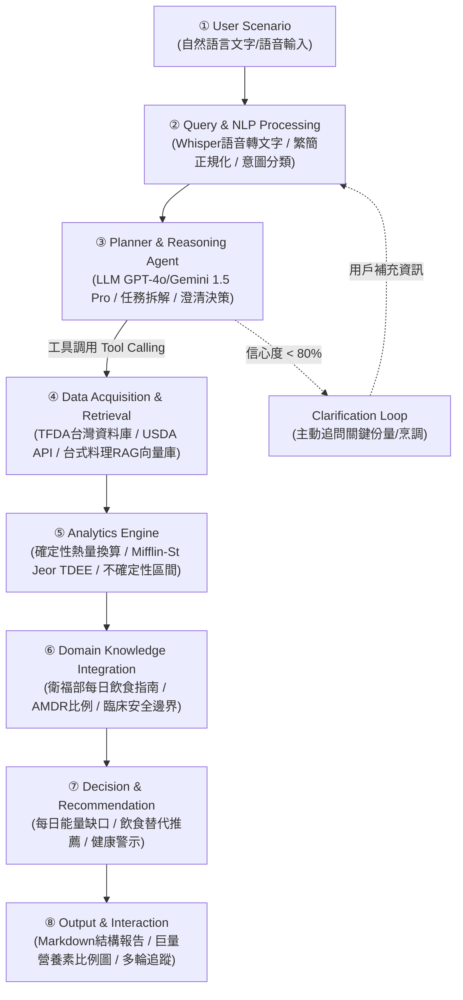
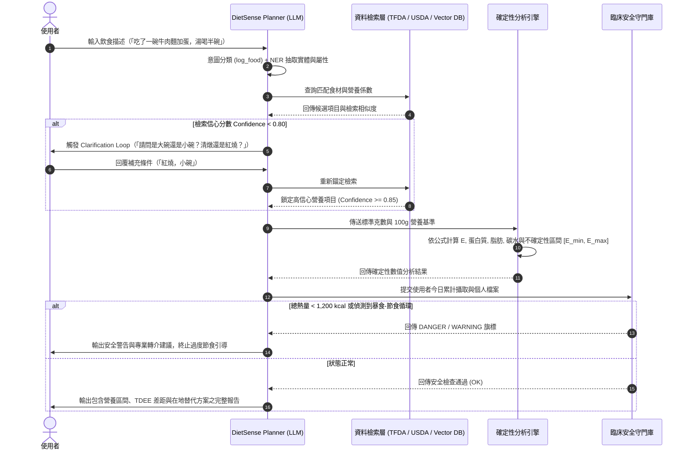

# Design: DietSense 領域智慧代理人系統架構與規格驅動設計

## Context

參考 `proposal.md` 之研究動機與痛點分析。本專案將原本非結構化之提案概念，透過 OpenSpec 規範轉換為具備工程可落實性與驗證機制的 Domain AI Agent。
系統的核心設計哲學為「**LLM 負責語意理解與規劃協調，領域工具負責確定性數值運算，安全規則庫負責臨床邊界防護**」。
在此架構下，系統嚴禁讓生成式語言模型直接無錨定地生成隨機卡路里數值，所有數值均經由官方檢驗資料庫與確定性代謝公式產出。

## Goals / Non-Goals

**Goals:**
- 建立端到端完整的八大代理人模組架構（輸入處理、意圖推理、多資料庫檢索、代謝分析、領域整合、決策建議、互動輸出）。
- 導入不確定性量化機制，對模糊份量與料理以信賴區間呈現，取代假精確的單一數值。
- 實作主動澄清迴圈（Clarification Loop），於信心低於 80% 門檻時自動發起結構化追問。
- 建立安全護欄，包含最低攝取下限（< 1,200 kcal/天）與暴食-節食循環偵測。
- 建立標準化評估管線，支援 500 筆台式料理基準與 MyFitnessPal 對照測試。

**Non-Goals:**
- 本系統不提供侵入性或具法律責任之醫療處方診斷，特殊疾患一律導向臨床專業醫師與營養師。
- 本階段不依賴特殊 3D 食物掃描儀或智慧型藍牙食物秤等外接硬體，專注於降低日常自然語言記錄之摩擦力。
- 不將受測者個人健康與飲食私密資料上傳至公開公共雲端平台，日誌均採本地持久化加密隔離。

## Architecture & Eight Core Modules

系統遵循期末專題提案標準，拆解為八大核心模組：



### 模組職責定義

1. **① User/Application Scenario**：支援使用者以日常中文對話記錄（例：「午餐吃了一碗加蛋牛肉麵，湯喝一半」），免除傳統 App 繁瑣的目錄點選。
2. **② Query/Input Processing**：以 Whisper 執行語音辨識；進行繁體中文正則化；意圖分類器判定四類行為：`log_food`、`query_nutrition`、`analyze`、`recommend`。
3. **③ Planner & Reasoning Agent**：基於 LLM Function Calling，維護對話歷史 Session，辨識缺失槽位（Slots）；當置信度不足時產出澄清問題。
4. **④ Data Acquisition / Retrieval**：
   - 台灣食品成分資料庫（TFDA，6,000+ 在地食材）。
   - USDA FoodData Central（900,000+ 食物項目與基礎原料）。
   - 台式料理向量資料庫（自建夜市小吃、便當與複合手搖飲 RAG）。
5. **⑤ Analytics Engine**：
   - 熱量計算：\(E = \text{portion(g)} \times \text{kcal}_{100g} / 100\)
   - 能量消耗：Mifflin-St Jeor 公式計算 BMR，乘上活動係數獲得 TDEE。
   - 不確定性量化：根據檢索信心計算信賴區間 \([E_{low}, E_{high}]\)。
6. **⑥ Domain Knowledge Integration**：衛福部每日飲食指南、AMDR 比例（碳水 45-65%、蛋白質 10-35%、脂肪 20-35%）、標準容器換算表與臨床警戒規則。
7. **⑦ Decision / Recommendation**：計算剩餘熱量額度、評估巨量營養素失衡、產出在地低卡替代食材方案。
8. **⑧ Output & Interaction**：結構化 Markdown 卡片回傳、區間可視化、圓餅圖比例數據與下一輪對話引導。

## Sequence Flow & Swimlane Diagram



## Algorithms & Pseudocode (with line numbers)

```python
01: """
02: Algorithm 1: DietSense — Data-Grounded Conversational AI Agent
03: Input : User Query Q, User Profile P, Daily Log D (historical records)
04: Output: Agent Response R, Updated Daily Log D'
05: """
06: def diet_agent_pipeline(Q: str, P: UserProfile, D: DailyLog) -> tuple[Response, DailyLog]:
07:     # Step 01: 語音轉譯與繁簡正規化
08:     Q_norm = normalize_natural_language(Q)
09:     
10:     # Step 02: 意圖解析 (Intent Classification)
11:     intent = classify_intent(Q_norm)  # {log_food, query_nutrition, analyze, recommend}
12:     
13:     # Step 03: 分支處理
14:     if intent == "log_food":
15:         entities = extract_food_entities(Q_norm)  # NER: [{food_name, portion, meal, time}]
16:         for item in entities:
17:             candidates = []
18:             candidates += query_tfda_database(item.name)
19:             candidates += query_usda_database(item.name)
20:             candidates += query_taiwan_vector_rag(item.name)
21:             
22:             best_match, confidence = rank_candidates(candidates, item.context)
23:             
24:             # 信心度閾值檢查與主動澄清迴圈
25:             if confidence < 0.80:
26:                 clarification_prompt = generate_targeted_question(item, candidates)
27:                 user_clarification = await ask_user_sync(clarification_prompt)
28:                 item = update_entity_with_clarification(item, user_clarification)
29:                 best_match, confidence = rank_candidates(query_all_sources(item.name), item.context)
30:             
31:             # 確定性熱量換算與不確定性傳遞
32:             grams = estimate_portion_grams(item.portion, best_match.standard_unit)
33:             kcal_point = (grams * best_match.kcal_per_100g) / 100.0
34:             kcal_low, kcal_high = calculate_uncertainty_interval(kcal_point, confidence)
35:             
36:             D.add_entry(food=best_match, portion_g=grams, 
37:                         kcal_point=kcal_point, bounds=(kcal_low, kcal_high), timestamp=item.time)
38:                         
39:     elif intent == "analyze":
40:         daily_total = sum(entry.kcal_point for entry in D.entries)
41:         macro_dist = compute_macronutrient_distribution(D)
42:         bmr = compute_mifflin_bmr(P.weight_kg, P.height_cm, P.age, P.gender)
43:         tdee = bmr * P.activity_multiplier
44:         deficit = daily_total - tdee
45:         
46:     elif intent == "recommend":
47:         recommendation = generate_taiwan_diet_alternatives(D, P, macro_dist)
48:         
49:     # Step 04: 臨床安全防護攔截 (Safety Guardrails)
50:     safety_status = evaluate_safety_guardrails(D, P)
51:     if safety_status == "DANGER":
52:         safety_alert = construct_safety_warning(reason="Extreme Caloric Deficit (<1200 kcal/day)")
53:         return format_response(alert=safety_alert, allow_restrictive_plan=False), D
54:         
55:     # Step 05: 產出結構化回應報告
56:     R = format_comprehensive_response(
57:         intent=intent, daily_log=D, 
58:         analytics_summary=(daily_total, tdee, deficit) if 'daily_total' in locals() else None,
59:         recommendations=recommendation if intent == "recommend" else None,
60:         source_provenance=[e.food.source for e in D.entries]
61:     )
62:     return R, D
```

## Mathematical Formulations & Uncertainty Quantification

### 1. 代謝能量平衡公式 (Mifflin-St Jeor)

基礎代謝率（BMR）計算：
$$
\text{BMR}_{\text{male}} = 10 \times W(\text{kg}) + 6.25 \times H(\text{cm}) - 5 \times A(\text{years}) + 5
$$
$$
\text{BMR}_{\text{female}} = 10 \times W(\text{kg}) + 6.25 \times H(\text{cm}) - 5 \times A(\text{years}) - 161
$$

總每日能量消耗（TDEE）：
$$
\text{TDEE} = \text{BMR} \times \text{PAL}
$$
其中身體活動水準係數（Physical Activity Level, PAL）：久坐為 1.2，輕度活動為 1.375，中度活動為 1.55，高度活動為 1.725。

### 2. 不確定性置信區間量化模型

單項食物熱量點估計：
$$
E = \frac{\text{Portion}(\text{g}) \times \text{kcal}_{100\text{g}}}{100}
$$

熱量區間上界與下界計算：
$$
\text{Margin} = E \times \left( \alpha + (1 - C) \times \beta \right)
$$
$$
E_{\text{low}} = E - \text{Margin}, \quad E_{\text{high}} = E + \text{Margin}
$$
其中 \(C \in [0, 1]\) 為檢索與抽取信心分數（Confidence Score），基準不確定性 \(\alpha = 0.08\)，動態放大係數 \(\beta = 0.35\)。當信心度為 1.0 時，保留食材天然變異誤差 ±8%；當信心度降至 0.6 時，區間擴大至 ±22%。

## Decisions

### Decision 1: 架構解耦 — LLM 協調 vs 領域工具計算
- **Rationale**: 通用 LLM 直接生成卡路里數值時 MAPE 高達 35.8%，且隨機幻覺嚴重。將數值運算完全抽離給確定性 Python 模組，可確保 100% 可重現性與數學準確性。
- **Alternatives Considered**: 曾考慮微調營養專用 LLaMA-3 模型；但微調仍無法杜絕浮點運算錯誤，且維護成本遠高於 RAG + 規則工具。

### Decision 2: 雙軌資料庫設計 — USDA + 台灣衛福部資料庫 + 自建 RAG 向量庫
- **Rationale**: USDA 具備完備的基礎食材微量元素，但對台灣夜市小吃、便當與手搖飲幾乎空白；結合 TFDA 資料庫與在地向量 RAG，可兼顧基礎營養科學與在地飲食覆蓋率。
- **Alternatives Considered**: 商業外包飲食 API（如 Nutritionix、FatSecret）；但授權費用昂貴、缺乏透明度且在地小吃台式口味覆蓋率有限。

### Decision 3: 置信區間取代單一精確數字
- **Rationale**: 自報飲食份量天然存在 18%–54% 誤差，偽精確的「一碗牛肉麵 632.4 大卡」會誤導使用者並降低公信力；提供 [580, 710] kcal 區間能誠實反映現實不確定性。
- **Alternatives Considered**: 強制要求使用者每日使用食物秤拍照上傳；經文獻證實會造成使用者心理負擔，超過 85% 人員無法持續 30 天。

## Risks / Trade-offs

- **[Risk 1: 未知料理與客製化私房菜無法檢索]** → **Mitigation**: 實作食材降級拆解機制（Fallback Decomposition），將料理分解為基礎澱粉、主肉類與油脂代理係數進行估算，並註明「近似重構值」。
- **[Risk 2: 過多追問導致使用者失去耐性中斷]** → **Mitigation**: 動態限制 Clarification Loop 單次交互僅詢問 1 個最關鍵問題（如大/小碗）；非關鍵參數採用台灣平均外食先驗中位數。
- **[Risk 3: 飲食失調與極端低熱量傷害使用者健康]** → **Mitigation**: 系統底層設置硬性安全閥門（Hard Guardrail），當使用者每日熱量目標低於 1,200 kcal 時拒絕執行並警示。

## Data Provenance, Sources & Privacy Security

1. **數據來源與版本控管**：
   - 台灣衛生福利部食品藥物管理署《食品營養成分資料庫》（2024–2025 年版）。
   - 美國農業部 USDA FoodData Central（SR Legacy & Foundation Foods）。
   - 自行標註之 500 筆台灣常見外食料理描述與熱量基準集。
2. **隱私與敏感個資保護**：
   - 使用者之身高、體重、年齡與飲食歷史日誌儲存於本地加密 SQLite 資料庫，不得作為公開訓練數據。
   - 所有雲端 LLM 呼叫進行去識別化（De-identification），不包含姓名、手機與定位等敏感個資。

## Verification & Evaluation Workflow

1. **基準測試（500 筆台式料理標註集）**：
   - 評估指標：MAE（平均絕對誤差）、MAPE、±10% 與 ±20% 誤差內達標率（目標 > 85%）。
2. **對照組實驗（A/B Testing vs. MyFitnessPal 手動記錄）**：
   - 召募 20 名受試者進行 7 天真實飲食追蹤，量測記錄平均耗時（目標縮短 60%）與放棄率。
3. **系統可用性量表（SUS Score）**：
   - 7 天實驗結束後填寫標準 10 題 SUS 問卷，目標可用性分數達成 SUS > 70（Good 等級）。

